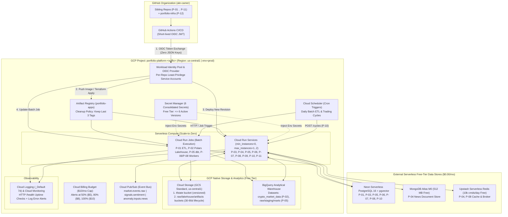

# Target GCP Architecture & Component Decisions (`P-01` to `P-12`)

This document defines the production target architecture on Google Cloud Platform (GCP) for the **Financial Markets Intelligence Platform** (`P-01` through `P-11`), provisioned and governed centrally from `portfolio-infra` (`P-12`) under a strict **< $10.00/month** budget ceiling.

---

## 1. Platform Topology & Governance Baseline

### 1.1 End-to-End Architecture Diagram



### 1.2 Global Naming, Region, and Labeling Conventions

All GCP resources provisioned by `portfolio-infra` enforce a uniform convention:

| Dimension | Standard Value | Rationale |
|---|---|---|
| **GCP Project ID** | `portfolio-platform-<suffix>` | Single project boundary simplifies IAM, VPC-less service communication, and centralized billing alerts. |
| **Primary Region** | `us-central1` | Eligible for GCP Free Tier quotas across Cloud Run (2M req/mo), Cloud Storage (5 GB Standard), and Artifact Registry. Eliminates cross-region egress fees. |
| **Environment** | `prod` | Single production showcase environment avoids duplicating fixed resources across `dev`/`staging`. |
| **Mandatory Labels** | `project=portfolio`, `env=prod`, `repo=<p01..p12>`, `managed_by=terraform` | Enables granular cost attribution per sibling repository in Cloud Billing reports. |

---

## 2. Two-Stage Terraform State & Module Architecture

### 2.1 Two-Stage State Bootstrap (`infra/bootstrap` -> `infra/platform`)

Terraform cannot store its state in a GCS bucket that does not yet exist. To avoid manual click-ops, `portfolio-infra` separates state bootstrapping from platform provisioning:

1. **Stage 1 — `infra/bootstrap/` (Local State, Executed Once in Issue #3)**:
   - Enables `storage.googleapis.com` and `iam.googleapis.com`.
   - Creates the remote state bucket `<project_id>-tfstate` in `us-central1` with:
     - `uniform_bucket_level_access = true`
     - `public_access_prevention = "enforced"`
     - `versioning { enabled = true }`
     - Lifecycle rule retaining the last `5` noncurrent state versions and deleting older versions after `30` days.
2. **Stage 2 — `infra/platform/` (Remote GCS Backend, Issues #4–#20)**:
   - Configures `backend "gcs" { bucket = "<project_id>-tfstate", prefix = "platform/prod" }`.
   - Provisions all shared project APIs, `$10` billing budget, WIF pool/providers, Artifact Registry, Secret Manager shells, GCS buckets, BigQuery datasets, Pub/Sub topics, Cloud Scheduler jobs, Monitoring alerts, and per-repository Cloud Run Services/Jobs.

### 2.2 Reusable Terraform Module Contracts (`infra/modules/`)

Three standardized modules in `infra/modules/` eliminate boilerplate across the 11 sibling repositories:

| Module | Path | Key Inputs | Provisioned Resources & Outputs |
|---|---|---|---|
| **Cloud Run Service** | `infra/modules/cloud-run-service` | `service_name`, `repo_name`, `image`, `port`, `cpu` (`1000m`), `memory` (`512Mi`–`1Gi`), `min_instances` (`0`), `max_instances` (`1`–`2`), `env_vars`, `secret_env_vars`, `health_check_path` (`/health`), `allow_unauthenticated` | `google_cloud_run_v2_service` (`INGRESS_TRAFFIC_ALL`, CPU throttled when idle, startup & liveness probes on `/health`), dedicated runtime SA, IAM invoker binding. Outputs `service_url`, `service_name`, `service_account_email`. |
| **Cloud Run Job** | `infra/modules/cloud-run-job` | `job_name`, `repo_name`, `image`, `command`, `args`, `cpu` (`1000m`), `memory` (`512Mi`–`1Gi`), `max_retries` (`1`), `task_timeout` (`900s`), `env_vars`, `secret_env_vars`, `schedule_cron` (optional) | `google_cloud_run_v2_job`, dedicated runtime SA, optional `google_cloud_scheduler_job` trigger with OIDC auth. Outputs `job_name`, `scheduler_job_name`. |
| **Deploy Service Account (WIF)** | `infra/modules/deploy-service-account` | `repo_name` (`ale-camer/<repo>`), `wif_pool_name`, `runtime_sa_emails`, `artifact_registry_id` | `google_service_account` (`sa-deploy-<repo>`), `roles/iam.workloadIdentityUser` bound strictly to `attribute.repository == "ale-camer/<repo>"`, `roles/artifactregistry.writer`, `roles/run.developer`, and `roles/iam.serviceAccountUser` on the repo's runtime SA only. |

---

## 3. Keyless Security & Workload Identity Federation (OIDC)

Long-lived Service Account JSON keys (`GOOGLE_APPLICATION_CREDENTIALS` JSON blobs in GitHub Secrets) are strictly prohibited:

1. **Workload Identity Pool & GitHub OIDC Provider**:
   - Pool: `github-actions-pool`
   - Provider: `github-oidc-provider` (`issuer_uri = "https://token.actions.githubusercontent.com"`)
   - Attribute condition restricting token exchange exclusively to the `ale-camer` GitHub owner:
     ```hcl
     attribute_condition = "assertion.repository_owner == 'ale-camer'"
     ```
2. **Separation of Duties (Deploy SA vs. Runtime SA)**:
   - **Deploy SA (`sa-deploy-<repo>`)**: Assumed momentarily by GitHub Actions via `google-github-actions/auth@v2`. Can push Docker images to Artifact Registry and update that repository's Cloud Run Service/Job. Cannot read application secrets in Secret Manager.
   - **Runtime SA (`sa-run-<repo>`)**: Attached to the Cloud Run Service or Job container at execution time. Granted `roles/secretmanager.secretAccessor` only on the specific secrets required by that repository, plus scoped GCS bucket or BigQuery dataset roles.

---

## 4. Workload-to-Infrastructure Mapping (`P-01` to `P-11`)

### 4.1 Compute & Scheduling Layer (Cloud Run Services vs. Cloud Run Jobs)

Always-on orchestrators (`apache-airflow` containers in `P-01`, `P-05`, `P-08`, `P-09`, `P-10` or Cloud Composer at ~$300+/mo) are replaced by **Cloud Run Jobs** and **Cloud Scheduler** HTTP triggers:

| Project | Workload Type | GCP Compute Resource | Scaling & CPU/Memory Profile | Trigger / Invocation Mechanism |
|---|---|---|---|---|
| **P-01** `financial-markets-pipeline` | Daily Batch ETL | **Cloud Run Job** (`p01-daily-etl`) | `1 vCPU`, `512Mi`, timeout `600s`, `max_retries=1` | **Cloud Scheduler** (`0 22 * * 1-5` UTC, post US market close) |
| **P-02** `crypto-analytics-platform` | Daily Lakehouse ETL | **Cloud Run Job** (`p02-crypto-etl`) | `1 vCPU`, `1Gi` (Polars), timeout `600s` | **Cloud Scheduler** (`0 1 * * *` UTC daily) |
| **P-03** `real-time-market-events` | Event Ingestion & Query API | **Cloud Run Service** (`p03-market-events`) | `1 vCPU`, `512Mi`, `min=0`, `max=1`, port `8000` | Public HTTPS (`GET /health`, `/metrics`, REST) + Pub/Sub push |
| **P-04** `financial-news-intelligence-api` | FinBERT NLP News API | **Cloud Run Service** (`p04-news-api`) | `1 vCPU`, `1Gi` (FinBERT CPU), `min=0`, `max=1`, port `8000` | Public HTTPS (`GET /health`, `/api/v1/*`) + Pub/Sub push |
| **P-05** `market-intelligence-hub` | Unified Market Hub API + dbt | **Cloud Run Service** (`p05-hub-api`) + **Cloud Run Job** (`p05-dbt-build`) | Service: `1 vCPU`, `512Mi`, `min=0`, `max=1`, port `8000`; Job: `1 vCPU`, `512Mi` | Service: Public HTTPS; Job: **Cloud Scheduler** (`0 2 * * *` UTC) |
| **P-06** `asset-anomaly-detection` | Anomaly API, Streamlit UI & Batch | **Cloud Run Service** (`p06-anomaly-api`) + **Cloud Run Job** (`p06-train-detect`) | Service: `1 vCPU`, `1Gi`, `min=0`, `max=1`, port `8000`; Job: `1 vCPU`, `1Gi` | Public HTTPS (`GET /health`, `POST /predict`) + On-demand/scheduled Job |
| **P-07** `financial-documents-rag` | SEC 10-K Hybrid RAG API | **Cloud Run Service** (`p07-docs-rag`) | `1 vCPU`, `512Mi`, `min=0`, `max=1`, port `8000` | Public HTTPS (`GET /health`, `POST /ingest`, `POST /query`) |
| **P-08** `ai-powered-market-intelligence` | E2E AI Signal API & NLP Worker | **Cloud Run Service** (`p08-market-intel`) + **Cloud Run Job** (`p08-nlp-worker`) | Service: `1 vCPU`, `1Gi`, `min=0`, `max=1`, port `8000`; Job: `1 vCPU`, `1Gi` | Public HTTPS (`GET /health`, REST/WS) + Batch Job |
| **P-09** `financial-research-agent` | Tool-Using Research Agent API | **Cloud Run Service** (`p09-research-agent`) | `1 vCPU`, `512Mi`, `min=0`, `max=2`, port `8000` | Public HTTPS + Internal HTTP called by `P-10` (`POST /research`) |
| **P-10** `autonomous-trading-analyst` | ReAct Paper Trading Agent API | **Cloud Run Service** (`p10-trading-analyst`) | `1 vCPU`, `512Mi`, `min=0`, `max=1`, port `8080` | Public HTTPS (`GET /health`) + **Cloud Scheduler** (`POST /cycles`) |
| **P-11** `multi-agent-market-intelligence` | Multi-Agent LangGraph Capstone API | **Cloud Run Service** (`p11-multi-agent`) | `1 vCPU`, `512Mi`, `min=0`, `max=1`, port `8000` | Public HTTPS (`GET /health`, multi-agent orchestration endpoints) |

### 4.2 Data, Storage, and Messaging Layer

| Storage / Messaging Tier | Target Cloud Service | Consuming Repositories | Cost & Lifecycle Controls |
|---|---|---|---|
| **Object Storage (Data Lake & Artifacts)** | **Google Cloud Storage (`us-central1` Standard)** | `P-01` (raw JSON), `P-02` (raw crypto JSON), `P-05` (data lake), `P-06` (MLflow/Evidently artifacts), `P-08` (NLP artifacts), `P-09` (`/app/data`), `P-10` (backtest traces) | Consolidated into `<project_id>-data-lake` and `<project_id>-artifacts` with prefix isolation (`p01/`, `p02/`, etc.) and `30`–`90` day lifecycle deletion rules (~$0.12/mo). |
| **Analytical Data Warehouse** | **Google BigQuery (`us-central1`)** | `P-02` (`crypto_market_data`), `P-05` (`raw_prod`, `staging_prod`, `marts_prod`) | Date-partitioned & symbol-clustered tables; fits within BigQuery 10 GB storage + 1 TB/month query Free Tier ($0.00/mo). |
| **Relational + Vector DB (`pgvector`)** | **Neon Serverless PostgreSQL 16 (Free Tier)** | `P-01`, `P-03`, `P-05`, `P-06`, `P-07` (`1536`-dim `pgvector`), `P-08` (`pgvector`), `P-10` (`pgvector` episodic memory) | Logical database/schema isolation (`financial_dw`, `market_events`, `rag_db`, `market_intel`, `trading`) inside a single scale-to-zero Neon project ($0.00/mo vs. ~$35/mo Cloud SQL). |
| **Document Database** | **MongoDB Atlas M0 (Free Tier, `us-central1`)** | `P-04` (`financial_news` collection + sentiment indices) | 512 MB shared cluster with TLS connection string in Secret Manager ($0.00/mo). |
| **In-Memory Cache & Broker** | **Upstash Serverless Redis (Free Tier)** | `P-04` (rate limit + NLP cache), `P-08` (deduplication + Celery queue) | 10,000 commands/day free tier over TLS ($0.00/mo vs. ~$35/mo Cloud Memorystore). |
| **Event Streaming Bus** | **Cloud Pub/Sub (Free Tier)** + Local Compose Kafka Demo | `P-03` (`market.events.raw`), `P-04` (`signals.sentiment`, `anomaly.inputs.news`), `P-05` (`market-events`), `P-08` | 10 GB/month free tier on Cloud Pub/Sub for cloud event routing; multi-broker Kafka + Schema Registry retained in repo `docker-compose.yml` for zero-cost local demos ($0.00/mo). |

### 4.3 Secret Management & IAM Least-Privilege Access (`<= 6` Active Versions)

Terraform creates **secret shells only** (`google_secret_manager_secret` with `automatic = true` replication); secret payloads are populated out-of-band via `gcloud secrets versions add` so no plaintext secret ever touches Terraform state:

| Secret ID | Authorized Runtime SAs (`roles/secretmanager.secretAccessor`) | Purpose |
|---|---|---|
| `portfolio-llm-api-key` | `sa-run-p07`, `sa-run-p08`, `sa-run-p09`, `sa-run-p10`, `sa-run-p11` | OpenAI / Gemini / Anthropic API keys for RAG and AI Agents |
| `portfolio-postgres-url` | `sa-run-p01`, `sa-run-p03`, `sa-run-p05`, `sa-run-p06`, `sa-run-p07`, `sa-run-p08`, `sa-run-p10` | Neon Serverless PostgreSQL + `pgvector` DSNs |
| `portfolio-market-api-keys` | `sa-run-p01`, `sa-run-p02`, `sa-run-p03`, `sa-run-p05`, `sa-run-p06`, `sa-run-p08` | CoinGecko, Alpha Vantage, Polygon, and Glassnode API keys |
| `portfolio-news-social-keys` | `sa-run-p04`, `sa-run-p05`, `sa-run-p08` | NewsAPI and Reddit OAuth credentials |
| `portfolio-nosql-cache-urls` | `sa-run-p04`, `sa-run-p08` | MongoDB Atlas M0 (`MONGODB_URI`) and Upstash Redis (`REDIS_URL`) |
| `portfolio-app-signing-keys` | `sa-run-p03`, `sa-run-p05`, `sa-run-p08` | JWT signing keys (`SECRET_KEY`, `API_SECRET_KEY`) |

### 4.4 Observability, Cost Guardrails, and Budget Enforcement

1. **Hard Budget Alert (`google_billing_budget`)**:
   - Provisioned first in Milestone 2 (`Issue #4`) with a **$10.00 USD/month** target and email notification channels at **50% ($5.00)**, **80% ($8.00)**, and **100% ($10.00)** of actual and forecasted spend.
2. **Cloud Logging & Monitoring (Free Tier)**:
   - `_Default` log bucket configured with **7-day retention** (well below the 50 GiB/month free tier).
   - Cloud Monitoring HTTP uptime checks probe `/health` on deployed Cloud Run Services at low frequency (`15 min` intervals) coupled with log-based `severity >= ERROR` alert policies.
3. **LLM Spend Protection (`P-07` to `P-11`)**:
   - Automated CI/CD smoke checks and scheduled trading cycles (`P-10`) default to `LLM_PROVIDER=fake` / `--mock` mode (`$0.00` token cost), while live OpenAI/Gemini calls enforce a hard monthly cap (`$2.00/mo` limit in provider billing settings) using `gpt-4o-mini` and `text-embedding-3-small`.

---

## 5. Architectural Decision Records (ADRs)

### ADR-001: Single Region (`us-central1`) and Single Environment (`prod`)
- **Context**: Deploying 11 microservices/pipelines across multiple regions or separate `dev`/`staging`/`prod` GCP projects multiplies fixed artifact storage, secret versions, and cross-region network egress costs.
- **Decision**: Consolidate all GCP resources into a single project (`portfolio-platform-<suffix>`), single region (`us-central1`), and single environment (`prod`).
- **Consequences**: Qualifies for GCP Always Free regional quotas (Cloud Run, GCS Standard, BigQuery), ensures `$0.00` intra-region data transfer, and keeps total platform spend at **~$1.62/month**.

### ADR-002: Two-Stage Terraform State Bootstrap (`infra/bootstrap` -> `infra/platform`)
- **Context**: Storing Terraform state in GCS requires the state bucket to exist before `terraform init` runs on the platform stack.
- **Decision**: Split Terraform into `infra/bootstrap/` (local state, run once to create the versioned `<project_id>-tfstate` bucket) and `infra/platform/` (remote GCS backend for all platform and workload resources).
- **Consequences**: 100% reproducible IaC bootstrap with state locking, encryption, versioning, and zero manual console steps.

### ADR-003: Keyless GitHub Actions Authentication via Workload Identity Federation (OIDC)
- **Context**: Storing static GCP Service Account JSON keys across 12 GitHub repositories creates a high-severity credential leakage risk and manual rotation burden.
- **Decision**: Use GCP Workload Identity Federation with an OIDC provider restricted to `assertion.repository_owner == 'ale-camer'` and dedicated per-repository `sa-deploy-<repo>` Service Accounts.
- **Consequences**: Short-lived (1-hour) OIDC tokens replace static keys; a compromised workflow in one repository cannot access another repository's Cloud Run service or runtime secrets.

### ADR-004: Scale-to-Zero Cloud Run Services & Jobs over GKE and Cloud Composer
- **Context**: Five repositories (`P-01`, `P-05`, `P-08`, `P-09`, `P-10`) define Apache Airflow DAGs, and nine expose FastAPI/Streamlit HTTP servers. Running GKE (~$70+/mo) or Cloud Composer (~$300+/mo) violates the `< $10/month` budget.
- **Decision**: Deploy all HTTP APIs as Cloud Run Services with `min_instances = 0` and all scheduled ETL/dbt/ML pipelines as Cloud Run Jobs triggered by Cloud Scheduler.
- **Consequences**: Compute cost drops to **$0.00 when idle** (~$0.45/mo total active execution) while preserving full container isolation and sub-2-second cold starts for lightweight FastAPI services.

### ADR-005: External Serverless Free-Tier Databases over Cloud SQL, Memorystore, and AWS RDS
- **Context**: `P-08` contains legacy AWS Terraform (`RDS`, `ElastiCache`, `ECS` ~$120/mo) and local Compose stacks require PostgreSQL/`pgvector`, MongoDB, Redis, and Kafka. Provisioning GCP Cloud SQL (~$35/mo) and Memorystore (~$35/mo) exceeds the budget 7x over.
- **Decision**: Replace `P-08` AWS IaC with GCP Cloud Run and connect stateful services to **Neon Serverless PostgreSQL 16 + `pgvector` Free Tier**, **MongoDB Atlas M0 Free Tier**, **Upstash Redis Free Tier**, and **Cloud Pub/Sub Free Tier** (retaining Docker Compose Kafka for local demos).
- **Consequences**: Eliminates >$170/month in always-on database/broker charges while providing managed TLS connections, native `pgvector` indexing, and zero idle cost.

### ADR-006: Platform-Level Secret Consolidation (`<= 6` Active Versions)
- **Context**: Individual `.env.example` files across `P-01` to `P-11` define ~35 overlapping environment variables. Creating 35 separate secrets in Google Secret Manager would cost ~$1.74/month above the 6-version free tier.
- **Decision**: Group shared credentials into **6 consolidated Secret Manager secrets** (`portfolio-llm-api-key`, `portfolio-postgres-url`, `portfolio-market-api-keys`, `portfolio-news-social-keys`, `portfolio-nosql-cache-urls`, `portfolio-app-signing-keys`) and pass non-sensitive settings as plain Terraform environment variables.
- **Consequences**: Keeps Secret Manager usage at exactly **6 active versions ($0.00/month)** with strict per-service IAM bindings.


