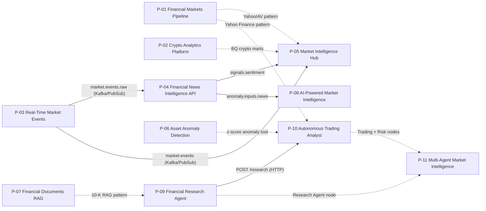

# Portfolio Infrastructure Audit & Inventory (`P-01` to `P-11`)

This document records the read-only technical audit of all 11 sibling repositories of the **Financial Markets Intelligence Platform** (`P-01` through `P-11`). Each repository is evaluated across a standardized 7-dimension schema:
1. **Runtime Services & Processes**
2. **Databases, Warehouses & Object Storage**
3. **Environment Variables & Secrets**
4. **Exposed Ports & Health Probes**
5. **Upstream / Downstream Portfolio Dependencies**
6. **Dockerfile, Compose, Terraform & CI Readiness**
7. **GCP Cloud Deployment Pattern & Monthly Cost Estimate**

---

## Executive Summary Matrix

| ID | GitHub Repo (`ale-camer/*`) | Local Directory | Primary Runtime | Data Stores | Port(s) | Dockerfile | CI Status | Cloud Pattern | Est. GCP Cost / Mo |
|---|---|---|---|---|---|---|---|---|---|
| **P-01** | `financial-markets-pipeline` | `financial-markets-pipeline` | Airflow 2.10 (`LocalExecutor`) batch ETL | SQLite (raw/staging), PostgreSQL 16 (`market_data`), GCS | `8080`, `5432` | Root (`apache/airflow:2.10.5-python3.11`) | Active (`ci.yml` + `cd.yml`) | Cloud Run Job + Cloud Scheduler + GCS | `$0.02` |
| **P-02** | `crypto-analytics-platform` | `crypto-analytics-platform` | Airflow 2.9+ (`TaskFlow`) + Polars ETL | GCS (raw JSON), BigQuery (`crypto_market_data.prices`) | `8080` (local CLI) | None (missing root `Dockerfile`) | None (missing `.github/workflows/ci.yml`) | Cloud Run Job + Cloud Scheduler + BigQuery + GCS | `$0.02` |
| **P-03** | `real-time-market-events` | `real-time-market-events` | FastAPI + Faust Worker + WS/REST Kafka Producer | Kafka 7.5 + Zookeeper, TimescaleDB PG14 (`market_events`), GCS | `8000`, `3000`, `9092`, `5432` | Root (`python:3.11-slim`) | Active (`ci.yml`) | Cloud Run Service (`api`) + Pub/Sub (cloud) / Compose (Kafka/Faust demo) | `$0.10` |
| **P-04** | `financial-news-intelligence-api` | `financial-news-analysis-api` | FastAPI + FinBERT / spaCy NLP pipeline | MongoDB 7.0 (`financial_news`), Redis 7.2, Kafka 7.6, GCS | `8000`, `27017`, `6379`, `9092` | Root + `infra/docker/Dockerfile` (`python:3.14-slim`) | Placeholder (`ci.yml` empty triggers) | Cloud Run Service (min=0, CPU-only FinBERT) + MongoDB Atlas M0 | `$0.25` |
| **P-05** | `market-intelligence-hub` | `market-intelligence-hub` | FastAPI + Airflow 2.8 + dbt-bigquery + Great Expectations | PostgreSQL 15 (`market_intelligence`), BigQuery (`raw`/`staging`/`marts`), Kafka, GCS | `8000`, `8080`, `3000`, `5432`, `9092` | Missing app `Dockerfile` (Compose uses upstream Airflow image) | Active (`ci.yml`) | Cloud Run Service (`api`) + Cloud Run Job (dbt/ETL) + BigQuery + GCS | `$0.10` |
| **P-06** | `asset-anomaly-detection` | `asset-anomaly-detection` | FastAPI inference + Streamlit UI + MLflow + Airflow 2.9 | PostgreSQL 15 (`anomaly_detection_db`, `mlflow_db`), MinIO/GCS (`mlflow-artifacts`, `data-lake`) | `8000`, `8501`, `5000`, `8080`, `9000`, `9001` | `docker/mlflow/Dockerfile` & `docker/streamlit/Dockerfile` (missing root API `Dockerfile`) | Active (`ci.yml` + Docker builds) | Cloud Run Services (`api` + `streamlit`, min=0) + GCS artifacts | `$0.20` |
| **P-07** | `financial-documents-rag` | `financial-documents-rag` | FastAPI RAG service (`langchain` + hybrid retrieval) | PostgreSQL 16 + `pgvector` (`financial_rag`, HNSW index) | `8000`, `5432` | Root multi-stage (`python:3.11-slim`) | Active (`ci.yml`) | Cloud Run Service (`api`, min=0) + Neon/Supabase free `pgvector` | `$0.10` |
| **P-08** | `ai-powered-market-intelligence` | `ai-powered-market-intelligence` | FastAPI + Celery Worker + Celery Beat + Airflow 2.9 | PostgreSQL 16 + `pgvector` (`market_intel`), Redis 7 (`0/1/2`), GCS | `8000`, `5432`, `6379`, `9090`, `3000` | Root multi-stage (`python:3.12-slim` + `tini` entrypoint) | Active (`ci.yml`, `security.yml`, `pr_hygiene.yml`, `release.yml`) | Cloud Run Service (`api`) + Cloud Run Job (`worker`) + Upstash/Neon free tiers | `$0.25` |
| **P-09** | `financial-research-agent` | `financial-research-agent` | FastAPI (`create_app`) + CLI (`financial-research-agent`) + Airflow DAGs | Local filesystem / GCS (`/app/data`) + configurable `VECTOR_STORE_URL` | `8000` | Root (`python:3.11-slim`, non-root UID `10001`) | Active (`ci.yml` with Ruff, Mypy, Pytest, Bandit, `pip-audit`, Docker) | Cloud Run Service (`api`, min=0) + GCS bucket | `$0.10` |
| **P-10** | `autonomous-trading-analyst` | `autonomous-trading-analysis` | FastAPI ReAct agent (`:8080`) + Airflow 3 standalone (`:8081`) + `backtest` CLI | PostgreSQL 16 + `pgvector` (`trading`), GCS (`GCS_ARTIFACTS_BUCKET`) | `8080`, `8081`, `5432` | Root (`python:3.12-slim`, non-root UID `50000`) | Active (`ci.yml` running `make ci`) | Cloud Run Service (`api`, min=0) + Cloud Scheduler (`/cycles`) + GCS | `$0.10` |
| **P-11** | `multi-agent-market-intelligence` | `multi-agent-market-intelligence` | FastAPI + LangGraph 3-agent orchestrator (Research, Trading, Risk) | Stateless in-memory LangGraph state (optional GCS/DB extensions) | `8000` | Root (`python:3.12-slim`, non-root UID `1000`) | Active (`ci.yml` with lint, matrix tests, live Docker `/health` check) | Cloud Run Service (`api`, min=0) | `$0.05` |

---

## Detailed Repository Audits: Data Engineering & APIs (`P-01` to `P-05`)

### P-01: `financial-markets-pipeline`
- **Repository**: `https://github.com/ale-camer/financial-markets-pipeline` (Local: `/home/alejandrocamerlengo/Projects/financial-markets-pipeline`)
- **1. Runtime Services**:
  - `airflow-init`: Runs `airflow db migrate` and creates admin user.
  - `airflow-webserver` & `airflow-scheduler`: Apache Airflow `2.10.5-python3.11` (`LocalExecutor`) running the daily batch DAG `financial_market_daily_pipeline`.
  - Python ETL (`src/`): Yahoo Finance (`yfinance`) and Alpha Vantage (`alpha-vantage`) extractors, Pydantic v2 validators, Polars transformers, and SQLite/PostgreSQL/GCS loaders.
- **2. Databases & Storage**:
  - **SQLite**: Local file-backed raw and staging layers (`./data`).
  - **PostgreSQL 16 (`postgres:16-alpine`)**: Metadata DB (`airflow`) plus curated star-schema DB (`market_data` with `dim_companies`, `fct_daily_prices`, `fct_dividends`).
  - **Google Cloud Storage**: Optional raw JSON archive bucket (`GCS_BUCKET_NAME=ale-camer-financial-markets-raw`).
- **3. Required Secrets & Env Vars**:
  - External API: `ALPHA_VANTAGE_API_KEY`.
  - Database: `POSTGRES_USER`, `POSTGRES_PASSWORD`, `POSTGRES_DB`, `CURATED_POSTGRES_USER`, `CURATED_POSTGRES_PASSWORD`, `CURATED_POSTGRES_DB`, `AIRFLOW__DATABASE__SQL_ALCHEMY_CONN`.
  - Airflow: `AIRFLOW__CORE__FERNET_KEY`, `AIRFLOW__WEBSERVER__SECRET_KEY`, `_AIRFLOW_WWW_USER_PASSWORD`.
  - GCP: `GCS_BUCKET_NAME`, `GOOGLE_APPLICATION_CREDENTIALS` (replaced by Cloud Run SA in GCP).
- **4. Exposed Ports & Health Probes**:
  - `8080`: Airflow Webserver (`GET http://localhost:8080/health`).
  - `5432`: PostgreSQL (`pg_isready -U airflow -d airflow`).
- **5. Dependencies**:
  - **Upstream**: External APIs only (Yahoo Finance, Alpha Vantage).
  - **Downstream**: Conceptual market data pattern reused by `P-05` and `P-10`.
- **6. Dockerfile, IaC & CI Readiness**:
  - `Dockerfile`: Present at root; extends `apache/airflow:2.10.5-python3.11` and installs `requirements.txt` (`sqlalchemy<2.0`, `polars`, `yfinance`, `google-cloud-storage`).
  - `infra/`: None in repo.
  - `.github/workflows/`: Both `ci.yml` (Ruff + Pytest unit tests on PR) and `cd.yml` (`docker compose build` + integration tests on push to `main`) exist.
- **7. Cloud Deployment & Monthly Cost**:
  - Avoid Cloud Composer (~$300+/mo). Package the Python ETL entrypoint as a **Cloud Run Job** triggered daily by **Cloud Scheduler**, writing raw archives to **GCS** and curated tables to shared serverless PostgreSQL (Neon free tier) or BigQuery.
  - **Estimated Cost**: **~$0.02/month** (GCS Standard storage + 1 daily Cloud Run Job execution within free tier).

---

### P-02: `crypto-analytics-platform`
- **Repository**: `https://github.com/ale-camer/crypto-analytics-platform` (Local: `/home/alejandrocamerlengo/Projects/crypto-analytics-platform`)
- **1. Runtime Services**:
  - Batch ETL pipeline (`src/extractors`, `src/transformers`, `src/loaders`, `src/dags/crypto_daily_pipeline.py`) using `httpx`, `pydantic>=2.0`, `polars>=1.0`, and `apache-airflow>=2.9.0` (TaskFlow API) to compute MACD, RSI-14, and Bollinger Bands on CoinGecko data.
- **2. Databases & Storage**:
  - **Google Cloud Storage**: Raw JSON archive bucket (`${var.project_id}-crypto-raw-archive` / `GCS_BUCKET_RAW`).
  - **Google BigQuery**: Dataset `crypto_market_data` (or `BQ_DATASET=crypto_analytics`) and time-partitioned (`DAY` on `fetched_at`), clustered (`coin_id`) table `prices`.
- **3. Required Secrets & Env Vars**:
  - External API: `COINGECKO_API_KEY`.
  - GCP: `GCP_PROJECT_ID`, `GCP_REGION` (`europe-west1`), `GCS_BUCKET_RAW`, `BQ_DATASET`, `BQ_LOCATION` (`EU`), `GOOGLE_APPLICATION_CREDENTIALS`.
- **4. Exposed Ports & Health Probes**:
  - `8080`: Only when running `airflow standalone` locally; no long-lived HTTP server required in production.
- **5. Dependencies**:
  - **Upstream**: CoinGecko REST API.
  - **Downstream**: Standalone analytical warehouse in BigQuery; complements `P-05` mart layer.
- **6. Dockerfile, IaC & CI Readiness**:
  - `Dockerfile` & `docker-compose.yml`: **Missing** (needs a lean Python 3.12 container image for Cloud Run Jobs in M4 Issue #11).
  - `terraform/`: Contains existing standalone HCL (`main.tf`, `bigquery.tf`, `storage.tf`, `variables.tf`) defining `google_bigquery_dataset.crypto_market_data`, `google_bigquery_table.crypto_prices`, and `google_storage_bucket.raw_archive` (to be consolidated into `portfolio-infra` in M2/M4).
  - `.github/workflows/`: **Missing** `ci.yml`.
- **7. Cloud Deployment & Monthly Cost**:
  - Run the daily Polars ETL as a **Cloud Run Job** triggered by **Cloud Scheduler**, writing to **GCS** and **BigQuery** (10 GB active storage and 1 TB queries/month free).
  - **Estimated Cost**: **~$0.02/month** (GCS bucket storage; BigQuery and Cloud Run Job stay within GCP Free Tier).

---

### P-03: `real-time-market-events`
- **Repository**: `https://github.com/ale-camer/real-time-market-events` (Local: `/home/alejandrocamerlengo/Projects/real-time-market-events`)
- **1. Runtime Services**:
  - `producer`: `python -m src.producers.kafka_producer` (WebSocket/REST ingestion from CoinGecko & Polygon.io with Avro/Pydantic validation).
  - `faust-worker`: `faust -A src.consumers.agents worker -l info` (stream normalization, OHLCV windowed aggregations, DLQ routing).
  - `api`: `uvicorn src.api.main:app --host 0.0.0.0 --port 8000` (FastAPI REST + WebSocket push).
  - Local infra containers: `zookeeper` (`confluentinc/cp-zookeeper:7.5.0`), `kafka` (`confluentinc/cp-kafka:7.5.0`), `timescaledb` (`timescale/timescaledb:latest-pg14`), and `grafana` (`grafana/grafana-oss:10.4.0`).
- **2. Databases & Storage**:
  - **Apache Kafka**: Topics `market.events.crypto`, `market.events.forex`, `market.events.stocks`, `market.events.dlq`.
  - **TimescaleDB / PostgreSQL 14**: Database `market_events` via `asyncpg` + SQLAlchemy 2.0 + Alembic migrations.
  - **Google Cloud Storage**: Optional cold archive (`GCS_BUCKET_NAME`).
- **3. Required Secrets & Env Vars**:
  - External APIs: `COINGECKO_API_KEY`, `POLYGON_API_KEY`.
  - Messaging & DB: `KAFKA_BOOTSTRAP_SERVERS` / `KAFKA_BROKER_URL`, `KAFKA_SASL_USERNAME`, `KAFKA_SASL_PASSWORD`, `TIMESCALE_PASSWORD`, `DATABASE_URL`.
  - App/Auth: `API_SECRET_KEY`, `AIRFLOW__CORE__FERNET_KEY`, `AIRFLOW__WEBSERVER__SECRET_KEY`, `GRAFANA_ADMIN_PASSWORD`.
- **4. Exposed Ports & Health Probes**:
  - `8000`: FastAPI service.
  - `3000`: Grafana UI.
  - `9092` / `29092`: Kafka broker (`kafka-broker-api-versions --bootstrap-server localhost:9092`).
  - `2181`: Zookeeper.
  - `5432`: TimescaleDB.
- **5. Dependencies**:
  - **Upstream**: CoinGecko WS, Polygon.io WS, Alpha Vantage REST.
  - **Downstream**: `P-04` consumes `market.events.raw` (`P03_KAFKA_TOPIC_MARKET_EVENTS`); `P-05` consumes `market-events`.
- **6. Dockerfile, IaC & CI Readiness**:
  - `Dockerfile`: Present at root (`python:3.11-slim`, includes `patches/fix_faust_tracing.py` and Alembic migrations; runs as `root` by default).
  - `infra/`: Contains `infra/grafana/` provisioning & dashboards; `infra/terraform/` is empty (`.gitkeep`).
  - `.github/workflows/ci.yml`: Active (Ruff lint/format, Mypy strict, Pytest with 80% coverage threshold).
- **7. Cloud Deployment & Monthly Cost**:
  - Deploy `api` to **Cloud Run Service** (`min_instances = 0`) backed by **Cloud Pub/Sub** (free up to 10 GB/month) for serverless event ingestion and shared PostgreSQL (`market_events` schema). Full Zookeeper + Kafka + Faust cluster remains a Docker Compose local/demo profile to avoid $100+/mo managed Kafka costs.
  - **Estimated Cost**: **~$0.10/month** (Artifact Registry image + scale-to-zero Cloud Run + Pub/Sub free tier).

---

### P-04: `financial-news-intelligence-api`
- **Repository**: `https://github.com/ale-camer/financial-news-intelligence-api` (Local: `/home/alejandrocamerlengo/Projects/financial-news-analysis-api`)
- **1. Runtime Services**:
  - `api`: FastAPI service (`uvicorn src.api.main:app --host 0.0.0.0 --port 8000`) performing RSS/NewsAPI/scraper ingestion, FinBERT (`ProsusAI/finbert`) sentiment analysis, and spaCy (`en_core_web_sm`) NER.
  - Supporting Compose services: `mongodb` (`mongo:7.0`), `redis` (`redis:7.2-alpine`), `zookeeper` (`cp-zookeeper:7.6.0`), `kafka` (`cp-kafka:7.6.0`).
- **2. Databases & Storage**:
  - **MongoDB 7.0**: Database `financial_news`, collection `articles` (`motor` / `pymongo`).
  - **Redis 7.2**: Cache DB `0` (`REDIS_CACHE_TTL=3600`).
  - **Apache Kafka**: Topics `news.raw`, `news.processed`.
  - **PostgreSQL**: Listed in `pyproject.toml` (`sqlalchemy`, `psycopg2-binary`) for relational metadata.
  - **Google Cloud Storage**: Article backup bucket (`GCS_BUCKET_NAME`).
- **3. Required Secrets & Env Vars**:
  - External API: `NEWSAPI_API_KEY`.
  - Data stores: `MONGODB_URI` / `MONGODB_URL`, `REDIS_URL` / `REDIS_HOST`, `KAFKA_BOOTSTRAP_SERVERS`.
  - GCP: `GCP_PROJECT_ID`, `GCP_REGION`, `GCS_BUCKET_NAME`, `GCP_SERVICE_ACCOUNT_KEY_PATH`.
  - Cross-project topics: `P03_KAFKA_TOPIC_MARKET_EVENTS=market.events.raw`, `P05_KAFKA_TOPIC=signals.sentiment`, `P08_KAFKA_TOPIC=anomaly.inputs.news`.
- **4. Exposed Ports & Health Probes**:
  - `8000`: FastAPI (`GET http://localhost:8000/health`).
  - `27017`: MongoDB (`mongosh --eval "db.adminCommand('ping')"`).
  - `6379`: Redis (`redis-cli ping`).
  - `9092`: Kafka.
- **5. Dependencies**:
  - **Upstream**: NewsAPI, Yahoo/Investing.com RSS feeds, and `P-03` (`market.events.raw`).
  - **Downstream**: Publishes sentiment signals to `P-05` (`signals.sentiment`) and news anomaly inputs to `P-08` (`anomaly.inputs.news`).
- **6. Dockerfile, IaC & CI Readiness**:
  - `Dockerfile`: Identical multi-stage files at both root `Dockerfile` and `infra/docker/Dockerfile` using `python:3.14-slim` and non-root `appuser`. Note: includes CPU `torch` + `transformers` (`FinBERT`), producing a large (~1.5–2.5 GB) image requiring Cloud Run startup probe tuning and 1–2 GiB RAM allocation.
  - `infra/terraform/`: Empty (`.gitkeep`).
  - `.github/workflows/ci.yml`: **Placeholder only** (`branches: []`); needs activation during rollout (Issue #13).
- **7. Cloud Deployment & Monthly Cost**:
  - Deploy `api` as a **Cloud Run Service** (`min_instances = 0`, `memory = 2Gi`, CPU-only PyTorch wheel) connected to **MongoDB Atlas Free Tier (M0)** and **Upstash Redis Free Tier** (or in-memory fallback).
  - **Estimated Cost**: **~$0.25/month** (primarily Artifact Registry storage for the larger NLP container image; compute scales to zero).

---

### P-05: `market-intelligence-hub`
- **Repository**: `https://github.com/ale-camer/market-intelligence-hub` (Local: `/home/alejandrocamerlengo/Projects/market-intelligence-hub`)
- **1. Runtime Services**:
  - FastAPI serving layer (`src/api`, JWT auth with `python-jose` & `bcrypt`, Prometheus metrics).
  - `airflow-init`, `airflow-webserver`, `airflow-scheduler` (`apache/airflow:2.8.1-python3.10`, `LocalExecutor`).
  - Transformation & quality jobs: `dbt-bigquery` (`raw` → `staging` → `marts`) and `great-expectations`.
  - Supporting Compose services: `postgres` (`postgres:15-alpine`), `zookeeper`, `kafka` (`cp-kafka:7.5.0`), `grafana` (`grafana:10.2.0`).
- **2. Databases & Storage**:
  - **PostgreSQL 15**: OLTP database `market_intelligence` + `airflow` metadata DB.
  - **Google BigQuery**: Datasets `raw_${var.env}`, `staging_${var.env}`, `marts_${var.env}` (or `BIGQUERY_DATASET=market_intelligence_dw`).
  - **Google Cloud Storage**: Data lake bucket `${var.project_id}-${var.env}-data-lake` (`GCS_BUCKET_NAME=market-intelligence-raw`) with versioning and 90-day lifecycle deletion.
  - **Apache Kafka**: Topics `market-events`, `news-events`.
- **3. Required Secrets & Env Vars**:
  - External APIs: `COINGECKO_API_KEY`, `YFINANCE_API_KEY`, `NEWSAPI_KEY`, `GLASSNODE_API_KEY`.
  - Database & Auth: `POSTGRES_PASSWORD`, `DATABASE_URL`, `API_SECRET_KEY`, `AIRFLOW__CORE__FERNET_KEY`, `AIRFLOW__WEBSERVER__SECRET_KEY`, `GRAFANA_ADMIN_PASSWORD`.
  - GCP: `GCP_PROJECT_ID`, `GCP_REGION`, `GCS_BUCKET_NAME`, `BIGQUERY_DATASET`, `GOOGLE_APPLICATION_CREDENTIALS`.
- **4. Exposed Ports & Health Probes**:
  - `8000`: FastAPI REST API (`API_PORT=8000`).
  - `8080`: Airflow Webserver (`GET http://localhost:8080/health`).
  - `3000`: Grafana UI.
  - `5432`: PostgreSQL (`pg_isready -U postgres`).
  - `9092` / `29092`: Kafka.
  - `9090`: Prometheus metrics target.
- **5. Dependencies**:
  - **Upstream**: Consumes market events (`P-03`) and news sentiment events (`P-04`) alongside direct CoinGecko, Yahoo Finance, NewsAPI, and Glassnode extractors.
  - **Downstream**: Serves unified analytical marts and REST endpoints for downstream analytics/agents.
- **6. Dockerfile, IaC & CI Readiness**:
  - `Dockerfile`: **Missing** dedicated FastAPI/dbt application `Dockerfile` (`docker-compose.yml` only runs stock `apache/airflow:2.8.1-python3.10`; needs app `Dockerfile` in M4 Issue #14).
  - `infra/terraform/`: Contains working GCP Terraform (`main.tf`, `providers.tf`, `variables.tf`, `outputs.tf`) provisioning the GCS data lake bucket, 3 BigQuery datasets (`raw`, `staging`, `marts`), and a pipeline service account (`market-intel-pipeline-${var.env}`) — note it uses broad project-level `roles/storage.objectAdmin` and `roles/bigquery.dataEditor`, which will be tightened to resource-level least privilege in `portfolio-infra`.
  - `.github/workflows/ci.yml`: Active (Ruff lint, Ruff format check, Mypy strict, Pytest with 80% coverage).
- **7. Cloud Deployment & Monthly Cost**:
  - Deploy FastAPI as a **Cloud Run Service** (`min_instances = 0`) and scheduled dbt/extraction runs as a **Cloud Run Job**, backed by **BigQuery** and **GCS**.
  - **Estimated Cost**: **~$0.10/month** (Artifact Registry + GCS storage; BigQuery datasets and queries fit within GCP Free Tier).

---

## Detailed Repository Audits: MLOps & AI/RAG (`P-06` to `P-08`)

### P-06: `asset-anomaly-detection`
- **Repository**: `https://github.com/ale-camer/asset-anomaly-detection` (Local: `/home/alejandrocamerlengo/Projects/asset-anomaly-detection`)
- **1. Runtime Services**:
  - FastAPI real-time inference service (`uvicorn src.api.main:app --host 0.0.0.0 --port 8000`, `/predict`, `/health`, `/metrics`) serving Isolation Forest / LOF (`scikit-learn`) and Deep Autoencoder (`torch` / `onnx`) models with Evidently AI drift reporting.
  - `streamlit`: Interactive dashboard (`streamlit run src/ui/app.py --server.port=8501`).
  - `mlflow`: MLflow 2.12.0 tracking server & model registry (`:5000`).
  - `airflow-init`, `airflow-webserver`, `airflow-scheduler` (`apache/airflow:2.9.1`, `LocalExecutor`) running ingestion & retraining DAGs.
  - Supporting Compose services: `postgres` (`postgres:15-alpine`), `minio` (`minio/minio:latest`), `minio-create-buckets`.
- **2. Databases & Storage**:
  - **PostgreSQL 15**: Databases `anomaly_detection_db`, `mlflow_db`, and `airflow_db`.
  - **MinIO / S3-Compatible Object Storage (GCS in cloud)**: Buckets `mlflow-artifacts` and `data-lake` (`./data/raw`, `./data/processed`, `./data/features` Parquet files).
- **3. Required Secrets & Env Vars**:
  - External API: `COINGECKO_API_KEY`.
  - Database: `POSTGRES_USER`, `POSTGRES_PASSWORD`, `POSTGRES_DB`, `DATABASE_URL`.
  - MLOps & Storage: `MLFLOW_TRACKING_URI`, `MLFLOW_S3_ENDPOINT_URL`, `MINIO_ROOT_USER`, `MINIO_ROOT_PASSWORD`, `AWS_ACCESS_KEY_ID`, `AWS_SECRET_ACCESS_KEY`.
  - Airflow: `AIRFLOW_WWW_USER_PASSWORD`, `AIRFLOW_SECRET_KEY`.
- **4. Exposed Ports & Health Probes**:
  - `8000`: FastAPI inference API (`GET /health`, `GET /metrics`, `POST /predict`).
  - `8501`: Streamlit UI (`GET http://localhost:8501/_stcore/health`).
  - `5000`: MLflow Tracking Server.
  - `8080`: Airflow Webserver.
  - `9000` / `9001`: MinIO S3 API & Console.
  - `5432`: PostgreSQL (`pg_isready`).
- **5. Dependencies**:
  - **Upstream**: CoinGecko market metrics; conceptual anomaly pattern reused by `P-10`.
  - **Downstream**: Anomaly z-score signals reused in `P-10` (`autonomous-trading-analyst`).
- **6. Dockerfile, IaC & CI Readiness**:
  - `Dockerfile`: Has `docker/mlflow/Dockerfile` (`python:3.11-slim`) and `docker/streamlit/Dockerfile` (`python:3.11-slim`), but **lacks a dedicated FastAPI inference `Dockerfile`** (needed in M4 Issue #15).
  - `infra/`: Only `infra/docker/.gitkeep`; no Terraform yet.
  - `.github/workflows/ci.yml`: Active (`lint-and-test` with Ruff, Mypy, Pytest + `docker-build-check` validating `docker compose config` and building MLflow & Streamlit images).
- **7. Cloud Deployment & Monthly Cost**:
  - Avoid always-on Vertex AI Endpoints (~$70+/mo). Export trained ONNX/sklearn artifacts to **GCS** (`mlflow-artifacts` bucket) and serve FastAPI (`/predict`) + Streamlit UI on **Cloud Run** (`min_instances = 0`), with scheduled retraining via **Cloud Run Job**.
  - **Estimated Cost**: **~$0.20/month** (two scale-to-zero Cloud Run services + GCS model artifact bucket).

---

### P-07: `financial-documents-rag`
- **Repository**: `https://github.com/ale-camer/financial-documents-rag` (Local: `/home/alejandrocamerlengo/Projects/financial-documents-rag`)
- **1. Runtime Services**:
  - `api`: FastAPI RAG service (`uvicorn src.api.main:app --host 0.0.0.0 --port 8000`, `/query`, `/ingest`, `/health`, Prometheus `/metrics`) using `langchain` 0.3, `langchain-openai`, section-aware 10-K chunking (`tiktoken`, `beautifulsoup4`, `lxml`), and hybrid semantic + BM25 retrieval with citation verification.
  - Supporting Compose service: `db` (`pgvector/pgvector:pg16`).
- **2. Databases & Storage**:
  - **PostgreSQL 16 + `pgvector`**: Database `financial_rag` (`psycopg[binary,pool]>=3.1.18`, `pgvector>=0.3.0`) with HNSW vector index (1536-dim `text-embedding-3-small`).
- **3. Required Secrets & Env Vars**:
  - LLM & Observability: `OPENAI_API_KEY`, `EMBEDDING_MODEL` (`text-embedding-3-small`), `LLM_MODEL` (`gpt-4o-mini`), `LANGCHAIN_API_KEY`, `LANGCHAIN_TRACING_V2`, `LANGCHAIN_PROJECT`.
  - SEC EDGAR: `SEC_EDGAR_USER_AGENT` (mandatory fair-access header), `SEC_EDGAR_BASE_URL`.
  - Database: `POSTGRES_HOST`, `POSTGRES_PORT`, `POSTGRES_DB`, `POSTGRES_USER`, `POSTGRES_PASSWORD`.
- **4. Exposed Ports & Health Probes**:
  - `8000`: FastAPI RAG service (`GET /health`, `GET /metrics`).
  - `5432`: PostgreSQL + `pgvector` (`pg_isready -U rag_user -d financial_rag`).
- **5. Dependencies**:
  - **Upstream**: SEC EDGAR 10-K filings API, OpenAI Embeddings & Chat Completions API.
  - **Downstream**: Complements `P-09` (`financial-research-agent`) SEC filing retrieval capabilities.
- **6. Dockerfile, IaC & CI Readiness**:
  - `Dockerfile`: Multi-stage production `Dockerfile` at root (`python:3.11-slim`, virtual environment in `/opt/venv`, non-root `appuser`, `EXPOSE 8000`). Note: `testcontainers[postgres]>=4.0.0` is currently listed in runtime `dependencies` in `pyproject.toml` (can be moved to `dev` extras to shrink image).
  - `infra/`: None in repo.
  - `.github/workflows/ci.yml`: Active (`make install`, `make check`, `.venv/bin/pytest tests/unit/ -v`).
- **7. Cloud Deployment & Monthly Cost**:
  - Deploy `api` as a **Cloud Run Service** (`min_instances = 0`) connected to a shared serverless **PostgreSQL 16 + `pgvector`** instance (Neon or Supabase free tier, 0.5 GB free storage) instead of Cloud SQL (~$9–$50/mo).
  - **Estimated Cost**: **~$0.10/month** (Artifact Registry image + scale-to-zero Cloud Run + $0.00 Neon/Supabase `pgvector` tier).

---

### P-08: `ai-powered-market-intelligence`
- **Repository**: `https://github.com/ale-camer/ai-powered-market-intelligence` (Local: `/home/alejandrocamerlengo/Projects/ai-powered-market-intelligence`)
- **1. Runtime Services**:
  - `api`: FastAPI REST + WebSocket service (`/entrypoint.sh api`, port `8000`, JWT via `pyjwt`, Prometheus `/metrics`).
  - `celery_worker` (`/entrypoint.sh worker`) & `celery_beat` (`/entrypoint.sh beat`): Async NLP enrichment (`transformers` FinBERT, `spacy`, `openai`, `scikit-learn`) and scheduled task dispatch.
  - `apache-airflow>=2.9.0`: DAGs (`dags/`) for ingestion → transformation → vector loading.
  - Supporting Compose services: `postgres` (`pgvector/pgvector:pg16`), `redis` (`redis:7-alpine`), `prometheus` (`prom/prometheus:v2.51.0`), `grafana` (`grafana:10.4.0`).
- **2. Databases & Storage**:
  - **PostgreSQL 16 + `pgvector`**: Database `market_intel` (`sqlalchemy[asyncio]`, `asyncpg`, `alembic`, `pgvector>=0.3.0`).
  - **Redis 7**: DB `0` (hot-path deduplication cache), DB `1` (`CELERY_BROKER_URL`), DB `2` (`CELERY_RESULT_BACKEND`).
  - **Object Storage**: S3 in existing repo Terraform; mapped to **GCS** bucket in `portfolio-infra`.
- **3. Required Secrets & Env Vars**:
  - External APIs: `NEWSAPI_API_KEY`, `ALPHA_VANTAGE_API_KEY`, `REDDIT_CLIENT_ID`, `REDDIT_CLIENT_SECRET`, `REDDIT_USER_AGENT`, `SEC_EDGAR_EMAIL`.
  - AI / LLM: `OPENAI_API_KEY`, `OPENAI_MODEL` (`gpt-4o-mini`).
  - Database & Cache: `POSTGRES_PASSWORD`, `REDIS_URL`, `CELERY_BROKER_URL`, `CELERY_RESULT_BACKEND`.
  - Security & Observability: `SECRET_KEY`, `AIRFLOW__CORE__FERNET_KEY`, `SENTRY_DSN`.
- **4. Exposed Ports & Health Probes**:
  - `8000`: FastAPI + WebSocket (`GET http://localhost:8000/health`).
  - `5432`: PostgreSQL + `pgvector` (`pg_isready`).
  - `6379`: Redis (`redis-cli ping`).
  - `9090`: Prometheus.
  - `3000`: Grafana.
- **5. Dependencies**:
  - **Upstream**: NewsAPI, SEC EDGAR, Reddit (`praw`), Alpha Vantage, and `P-04` (`anomaly.inputs.news`).
  - **Downstream**: Delivers enriched market signal alerts and vector-indexed intelligence.
- **6. Dockerfile, IaC & CI Readiness**:
  - `Dockerfile`: Hardened multi-stage `Dockerfile` at root (`python:3.12-slim`, `tini`, UID/GID `10001` `marketintel`, `/entrypoint.sh` supporting `api`, `worker`, `beat`). Note: `Dockerfile` runs `pip install .` (core dependencies only) — building for production API/NLP requires `pip install ".[all]"` or explicit extras.
  - `infra/`: Contains `infra/terraform/` **written for AWS** (`provider "aws"`, VPC, S3, RDS `db.t4g.medium`, ElastiCache, ECS Fargate) — **must be replaced by GCP Cloud Run + GCS + serverless Postgres/Redis in `portfolio-infra`** (saving ~$120+/mo on AWS RDS/ElastiCache/NAT).
  - `.github/workflows/`: Comprehensive (`ci.yml` with Ruff, Mypy, Python 3.12/3.13 matrix tests with `pgvector` + `redis` service containers, Docker smoke check, Terraform validate; plus `security.yml`, `pr_hygiene.yml`, `release.yml`).
- **7. Cloud Deployment & Monthly Cost**:
  - Deploy `api` as a **Cloud Run Service** (`min_instances = 0`) and async enrichment batch runs as a **Cloud Run Job** triggered by **Cloud Scheduler**, using shared **Neon `pgvector` Free Tier** and **Upstash Redis Free Tier**.
  - **Estimated Cost**: **~$0.25/month** (Artifact Registry image + scale-to-zero Cloud Run + GCS).

---

## Detailed Repository Audits: AI Agents (`P-09` to `P-11`)

### P-09: `financial-research-agent`
- **Repository**: `https://github.com/ale-camer/financial-research-agent` (Local: `/home/alejandrocamerlengo/Projects/financial-research-agent`)
- **1. Runtime Services**:
  - `api`: FastAPI service (`uvicorn financial_research_agent.api.app:create_app --factory --host 0.0.0.0 --port 8000`) exposing `GET /health`, `POST /research`, `POST /ingest`, and `POST /transform`.
  - `cli`: Containerized CLI (`financial-research-agent`) for ad-hoc research, ingestion, and transformation.
  - `dags/`: Apache Airflow DAGs (`financial_ingestion_dag`, `financial_transform_dag`).
- **2. Databases & Storage**:
  - **Filesystem / GCS (`/app/data`)**: Atomic raw (`./data/raw`), processed (`./data/processed`), and local vector index (`./data/index`) storage.
  - **Vector Store**: Configurable via `VECTOR_STORE_URL` (local index or shared `pgvector` database).
- **3. Required Secrets & Env Vars**:
  - LLM: `LLM_API_KEY` (maps to `OPENAI_API_KEY`), `LLM_MODEL` (`gpt-4o` / `gpt-4o-mini`).
  - SEC EDGAR: `SEC_USER_AGENT` (`"Name email@example.com"`).
  - Storage: `VECTOR_STORE_URL`, `DATA_DIR` (`/app/data`).
- **4. Exposed Ports & Health Probes**:
  - `8000`: FastAPI HTTP server (`GET http://localhost:8000/health`).
- **5. Dependencies**:
  - **Upstream**: SEC EDGAR 10-K/10-Q filings, Yahoo Finance (`yfinance`), Financial News RSS (`feedparser`), OpenAI API.
  - **Downstream**: **Directly called by `P-10` (`autonomous-trading-analyst`) via `POST /research` (`RESEARCH_API_URL`)** as its fundamental research tool; conceptual Research Agent role in `P-11`.
- **6. Dockerfile, IaC & CI Readiness**:
  - `Dockerfile`: Production-ready at root (`python:3.11-slim`, `pip install ".[all]"`, non-root `appuser` UID `10001`, `HEALTHCHECK` on `:8000/health`, supports `--mock` mode without paid LLM calls).
  - `infra/`: Contains `infra/README.md` only; no Terraform yet.
  - `.github/workflows/ci.yml`: Active and production-grade (`lint-and-typecheck`, Python 3.11/3.12 `test` matrix, `security` with `pip-audit` + `bandit`, and `docker-build`).
- **7. Cloud Deployment & Monthly Cost**:
  - Deploy `api` as a **Cloud Run Service** (`min_instances = 0`) with a **GCS bucket** mounted or synced for `/app/data` artifacts.
  - **Estimated Cost**: **~$0.10/month** (Artifact Registry image + scale-to-zero Cloud Run + GCS).

---

### P-10: `autonomous-trading-analyst`
- **Repository**: `https://github.com/ale-camer/autonomous-trading-analyst` (Local: `/home/alejandrocamerlengo/Projects/autonomous-trading-analysis`)
- **1. Runtime Services**:
  - `api`: FastAPI ReAct trading agent (`uvicorn autonomous_trading_analyst.api:app --host 0.0.0.0 --port 8080`) exposing `POST /cycles`, `GET /portfolio`, `GET /decisions`, and `GET /health`. Enforces `TRADING_MODE=paper` only via deterministic `RiskManager` and `PaperBroker`.
  - `airflow`: Apache Airflow 3 standalone (`airflow standalone`, host port `8081:8080`) running the thin HTTP trigger DAG (`POST /cycles`).
  - CLI: `backtest` (`autonomous_trading_analyst.evaluation.cli:main`) for point-in-time backtest evaluation.
  - Supporting Compose service: `db` (`pgvector/pgvector:pg16`).
- **2. Databases & Storage**:
  - **PostgreSQL 16 + `pgvector`**: Database `trading` (`sqlalchemy>=2.0`, `psycopg[binary]>=3.2`, `pgvector>=0.3`) storing decisions, traces, paper orders, and 1536-dim episodic memory vectors (`infra/init-db.sql`).
  - **Google Cloud Storage**: Bucket (`GCS_ARTIFACTS_BUCKET`) for backtest reports and decision trace exports.
- **3. Required Secrets & Env Vars**:
  - Multi-provider LLM: `LLM_PROVIDER` (`fake` | `openai` | `anthropic` | `gemini`), `OPENAI_API_KEY`, `ANTHROPIC_API_KEY`, `GOOGLE_API_KEY`, `EMBEDDING_PROVIDER`.
  - Database: `DATABASE_URL`, `POSTGRES_USER`, `POSTGRES_PASSWORD`, `POSTGRES_DB`.
  - Upstream Agent Tool: `RESEARCH_API_URL` (`http://localhost:8000` → Cloud Run URL of `P-09` in production).
  - GCP: `GCP_PROJECT_ID`, `GCP_REGION` (`europe-west1`), `GCS_ARTIFACTS_BUCKET`, `GOOGLE_APPLICATION_CREDENTIALS`.
- **4. Exposed Ports & Health Probes**:
  - `8080`: FastAPI ReAct agent (`GET http://localhost:8080/health` — natively matches Cloud Run default `PORT=8080`).
  - `8081` (`8080` internal): Airflow standalone UI.
  - `5432`: PostgreSQL + `pgvector` (`pg_isready`).
- **5. Dependencies**:
  - **Upstream**: **Calls `P-09` (`POST /research`) via `RESEARCH_API_URL`**, reuses `P-01` Yahoo Finance pattern and `P-06` rolling z-score anomaly signal logic.
  - **Downstream**: Represents the Trading Analyst + Risk Manager workflow orchestrated in `P-11`.
- **6. Dockerfile, IaC & CI Readiness**:
  - `Dockerfile`: Production-ready at root (`python:3.12-slim`, `pip install --no-cache-dir .[all]`, non-root `trader` UID `50000`, `EXPOSE 8080`, `HEALTHCHECK` on `:8080/health`). Note: `.[all]` includes `apache-airflow>=3,<4`; a slimmer `.[tools,llm,memory,api,cloud]` install can be used for the Cloud Run API container to reduce image size.
  - `infra/`: Contains clean GCP Terraform (`infra/main.tf`, `variables.tf`, `outputs.tf`, `terraform.tfvars.example`) provisioning `google_storage_bucket.artifacts` with UBLA, versioning, and 90-day lifecycle cleanup.
  - `.github/workflows/ci.yml`: Active (`make venv && make deps && make ci`).
- **7. Cloud Deployment & Monthly Cost**:
  - Deploy `api` as a **Cloud Run Service** (`min_instances = 0`, `LLM_PROVIDER=fake` or `gemini`/`openai`) triggered on schedule by **Cloud Scheduler** (`POST /cycles`, replacing the always-on Airflow container), backed by shared **Neon `pgvector` Free Tier** and **GCS**.
  - **Estimated Cost**: **~$0.10/month** (Artifact Registry image + scale-to-zero Cloud Run + GCS artifacts bucket).

---

### P-11: `multi-agent-market-intelligence`
- **Repository**: `https://github.com/ale-camer/multi-agent-market-intelligence` (Local: `/home/alejandrocamerlengo/Projects/multi-agent-market-intelligence`)
- **1. Runtime Services**:
  - `api`: FastAPI + LangGraph multi-agent orchestration server (`uvicorn multi_agent_market_intelligence.api.app:app --host 0.0.0.0 --port 8000`) coordinating 3 specialized agents (Research Agent, Trading Analyst, Risk & Portfolio Manager) via explicit state & message passing.
- **2. Databases & Storage**:
  - **In-Memory State**: Stateless LangGraph execution with configurable initial paper cash (`API_DEFAULT_CASH=100000.0`); zero external database required to boot and pass `/health`.
- **3. Required Secrets & Env Vars**:
  - LLM: `OPENAI_API_KEY` (optional for deterministic/mock graph runs).
  - App config: `PROJECT_NAME`, `API_PORT=8000`, `API_HOST=0.0.0.0`, `API_DEBUG=false`, `API_DEFAULT_CASH=100000.0`.
- **4. Exposed Ports & Health Probes**:
  - `8000`: FastAPI HTTP service (`GET http://localhost:8000/health`).
- **5. Dependencies**:
  - **Upstream**: Synthesizes the domain patterns of `P-09` (Research Agent) and `P-10` (Trading Analyst + Risk Manager) into a unified LangGraph state machine.
  - **Downstream**: Top-level capstone API of the Financial Markets Intelligence Platform.
- **6. Dockerfile, IaC & CI Readiness**:
  - `Dockerfile`: Lean, fast-building production `Dockerfile` at root (`python:3.12-slim`, non-root `appuser` UID `1000`, `EXPOSE 8000`, zero heavy C/GPU compilation, stdlib `urllib.request` health probe).
  - `infra/`: Empty (`infra/.gitkeep`).
  - `.github/workflows/ci.yml`: Active and verified (`quality` with Ruff + Mypy strict, `test` on Python 3.11/3.12, and `docker` job that builds the image, runs the container on `:8000`, and curls `/health`).
- **7. Cloud Deployment & Monthly Cost**:
  - Deploy `api` as a **Cloud Run Service** (`min_instances = 0`, `cpu = 1`, `memory = 512Mi`).
  - **Estimated Cost**: **~$0.05/month** (smallest container image in the portfolio + scale-to-zero Cloud Run).

---

## Cross-Repository Dependency Matrix

| Project | Upstream Portfolio Producers | Downstream Portfolio Consumers | Integration Transport |
|---|---|---|---|
| **P-01** | — (External: Yahoo Finance, Alpha Vantage) | `P-05`, `P-10` (shared extraction patterns & curated schema) | Batch DB / Library pattern |
| **P-02** | — (External: CoinGecko REST) | `P-05` (shared BigQuery analytical warehouse) | BigQuery dataset |
| **P-03** | — (External: CoinGecko WS, Polygon WS) | `P-04` (`market.events.raw`), `P-05` (`market-events`) | Kafka (local) / Cloud Pub/Sub (cloud) |
| **P-04** | `P-03` (`market.events.raw`) | `P-05` (`signals.sentiment`), `P-08` (`anomaly.inputs.news`) | Kafka (local) / Cloud Pub/Sub (cloud) |
| **P-05** | `P-03`, `P-04` (`market-events`, `news-events`) | Portfolio-wide BigQuery marts (`marts_prod`) & REST API | Kafka/PubSub → BigQuery → FastAPI |
| **P-06** | — (External: CoinGecko) | `P-10` (rolling z-score anomaly signal logic) | Domain tool / HTTP `/predict` |
| **P-07** | — (External: SEC EDGAR, OpenAI) | `P-09` (SEC 10-K chunking & vector search pattern) | Shared `pgvector` / REST `/query` |
| **P-08** | `P-04` (`anomaly.inputs.news`) | Downstream signal consumers via REST/WebSocket | Kafka/PubSub + FastAPI WS |
| **P-09** | `P-07` (SEC EDGAR + RAG pattern) | **`P-10` (`POST /research` via `RESEARCH_API_URL`)**, `P-11` | Synchronous HTTP REST (`POST /research`) |
| **P-10** | **`P-09` (`RESEARCH_API_URL`)**, `P-01`, `P-06` | `P-11` (Trading Analyst + deterministic Risk Manager design) | Synchronous HTTP REST |
| **P-11** | `P-09`, `P-10` (agent roles & contracts) | End-user / Portfolio showcase API | FastAPI + LangGraph state machine |

---

## Shared Secret Deduplication Matrix

Google Secret Manager includes **6 active secret versions free per month** ($0.06/version/month thereafter). By consolidating overlapping API keys and database credentials across `P-01` through `P-11` into **6 platform-level secrets**, Secret Manager cost stays at **$0.00/month**:

| Consolidated Secret ID (Secret Manager) | Consuming Repositories | Environment Variable Mappings Across Repos |
|---|---|---|
| `1. portfolio-llm-api-key` | `P-07`, `P-08`, `P-09`, `P-10`, `P-11` | `OPENAI_API_KEY`, `LLM_API_KEY` (and optional JSON bundle for `ANTHROPIC_API_KEY` / `GOOGLE_API_KEY` in `P-10`) |
| `2. portfolio-postgres-url` | `P-01`, `P-03`, `P-05`, `P-06`, `P-07`, `P-08`, `P-10` | `DATABASE_URL`, `POSTGRES_PASSWORD`, `TIMESCALE_PASSWORD`, `VECTOR_STORE_URL` (shared serverless Postgres + `pgvector` with per-repo databases/schemas) |
| `3. portfolio-market-api-keys` | `P-01`, `P-02`, `P-03`, `P-05`, `P-06`, `P-08` | JSON/env bundle for `COINGECKO_API_KEY`, `ALPHA_VANTAGE_API_KEY`, `POLYGON_API_KEY`, `GLASSNODE_API_KEY` |
| `4. portfolio-news-social-keys` | `P-04`, `P-05`, `P-08` | JSON/env bundle for `NEWSAPI_API_KEY` (`NEWSAPI_KEY`), `REDDIT_CLIENT_ID`, `REDDIT_CLIENT_SECRET` |
| `5. portfolio-nosql-cache-urls` | `P-04`, `P-08` | JSON/env bundle for `MONGODB_URI` (MongoDB Atlas M0) and `REDIS_URL` (Upstash Redis free tier) |
| `6. portfolio-app-signing-keys` | `P-03`, `P-05`, `P-08` | `API_SECRET_KEY`, `SECRET_KEY` (JWT signing & internal service auth) |

> **Non-secret configuration** (`GCP_PROJECT_ID`, `GCP_REGION`, `GCS_BUCKET_NAME`, `BQ_DATASET`, `SEC_EDGAR_USER_AGENT`, `TRADING_MODE=paper`, `LOG_LEVEL`) is injected directly via Terraform Cloud Run environment variables rather than Secret Manager.

---

## M3 Pilot Repository Evaluation & Recommendation

To validate the end-to-end WIF → Artifact Registry → Terraform Cloud Run → `/health` smoke check pipeline in **Milestone 3 (Issues #9 and #10)** before rolling out all 11 projects in M4, we evaluated the top candidates:

| Criterion | `P-11` (`multi-agent-market-intelligence`) | `P-09` (`financial-research-agent`) | `P-07` (`financial-documents-rag`) | `P-10` (`autonomous-trading-analyst`) |
|---|---|---|---|---|
| **Root `Dockerfile` Ready** | ✅ Yes (`python:3.12-slim`, non-root) | ✅ Yes (`python:3.11-slim`, non-root) | ✅ Yes (`python:3.11-slim`, non-root) | ✅ Yes (`python:3.12-slim`, non-root) |
| **External DB Required for `/health`** | ✅ **No** (100% stateless boot) | ✅ **No** (uses `/app/data` + `--mock`) | ⚠️ Requires `pgvector` connection | ⚠️ Expects `DATABASE_URL` (`pgvector`) |
| **Image Build Time & Size** | ✅ **Fastest (~35s, ~220 MB)** | ✅ Fast (~50s, ~350 MB, includes Airflow) | ⚠️ Medium (~60s, includes `testcontainers`) | ⚠️ Medium (~75s, `.[all]` includes Airflow 3) |
| **Existing CI Docker `/health` Test** | ✅ **Yes** (`ci.yml` already runs & curls `/health`) | ✅ Builds image in CI | ❌ Unit tests only in CI | ❌ `make ci` only |

- **Primary M3 Pilot Recommendation**: **`P-11` (`multi-agent-market-intelligence`)** (with **`P-09` (`financial-research-agent`)** as secondary/paired validation).
  - **Rationale**: `P-11` has the smallest, fastest-building production `Dockerfile`, runs as non-root (`UID 1000`), requires zero external database or paid API key to boot and respond `200 OK` on `GET /health`, and already validates container `/health` in its GitHub Actions workflow. Deploying `P-11` first in M3 isolates pure GCP WIF, Artifact Registry, IAM, and Cloud Run networking from database connectivity issues.

---

## Aggregated Monthly GCP Cost Breakdown (< $10/Month Target)

| GCP / External Service | Provisioned Scope Across `P-01` – `P-12` | Pricing Tier & Optimization Strategy | Est. Monthly Cost (USD) |
|---|---|---|---|
| **Cloud Run Services (9 HTTP APIs)** | `P-03`, `P-04`, `P-05`, `P-06` (API + Streamlit), `P-07`, `P-08`, `P-09`, `P-10`, `P-11` | `min_instances = 0`, `max_instances = 1–2`, CPU allocated only during requests (2M requests + 180k vCPU-sec + 360k GiB-sec/mo free) | **$0.40** |
| **Cloud Run Jobs (4 Batch ETL/ML)** | `P-01` (daily ETL), `P-02` (daily Polars ETL), `P-05` (dbt job), `P-06`/`P-08` (batch workers) | Triggered once daily via Cloud Scheduler; fits within Cloud Run Jobs free tier | **$0.05** |
| **Artifact Registry** | 1 shared Docker repository (`portfolio-apps`) with cleanup policy keeping last 3 tags per service | First 0.5 GB free; `$0.10/GB/month` for ~5 GB total compressed images across 11 repos | **$0.45** |
| **Cloud Storage (GCS)** | 1 Terraform state bucket + consolidated data/artifact buckets with 30–90 day lifecycle rules | `$0.020/GB/month` Standard storage (~5 GB total raw archives, MLflow/backtest artifacts) | **$0.12** |
| **BigQuery** | Datasets for `P-02` (`crypto_market_data`) and `P-05` (`raw`, `staging`, `marts`) | 10 GB active storage + 1 TB queries/month free tier; partitioned & clustered tables | **$0.00** |
| **Cloud Pub/Sub** | Event topics replacing always-on Kafka for `P-03`, `P-04`, `P-05`, `P-08` | First 10 GB of messages per month free | **$0.00** |
| **Cloud Scheduler** | 3 jobs free/account + 1 additional job (`P-01`, `P-02`, `P-05`, `P-10` `/cycles`) | 3 free jobs/month; `$0.10/job/month` for the 4th job | **$0.10** |
| **Secret Manager** | 6 deduplicated platform secrets (1 active version each) | 6 active secret versions + 10,000 access operations/month free | **$0.00** |
| **Cloud Logging & Monitoring** | Centralized logs (`_Default` 7-day retention), uptime checks, and $10 budget alerts | First 50 GiB/month logs + alerting policies free | **$0.00** |
| **External Free-Tier Data Stores** | Neon Serverless Postgres + `pgvector` (free 0.5 GB), MongoDB Atlas M0 (free 512 MB), Upstash Redis (free 10k cmds/day) | Eliminates ~$35/mo Cloud SQL, ~$35/mo Memorystore, and ~$100/mo managed Kafka | **$0.00** |
| **LLM API Usage (Demo / Scheduled)** | `gpt-4o-mini` / `text-embedding-3-small` (`P-07`–`P-11`), with `--mock` / `fake` default for scheduled runs | Rate-limited live queries + deterministic fake/mock providers for automated smoke checks | **$0.50** |
| **Total Estimated Platform Spend** | **All 11 Portfolio Projects (`P-01` to `P-11`) + `P-12` (`portfolio-infra`)** | **83.8% below the $10.00/month hard budget cap** | **~$1.62 / month** |

